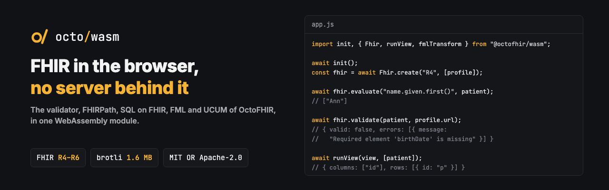

<p align="center"></p>

<p align="center"><b>The validator, FHIRPath, SQL on FHIR, FML and UCUM of OctoFHIR, in one WebAssembly module.</b></p>

<p align="center">
  <a href="https://github.com/octofhir/wasm/actions/workflows/ci.yml"></a>
  <a href="#license"></a>
</p>

The FHIR definitions of R4, R4B, R5 and R6 are inside: nothing is fetched, and nothing leaves the
page. That makes it fit for tools that handle patient data in the browser, for editors, and for
documentation with examples that really run.

```js
import init, { Fhir, runView, fmlCheck, fmlTransform, ucumValidate } from "@octofhir/wasm";

await init();
const fhir = await Fhir.create("R4", [profile]);   // profiles are optional

await fhir.evaluate("name.given.first()", patient);
await fhir.validate(patient, profile.url);
await runView(viewDefinition, [patient]);
fmlCheck(mapText, "R4");
await fmlTransform(mapText, patient, "R4");
ucumValidate("mg/dL");
```

| Function | Result |
|---|---|
| `Fhir.create(version, profiles?)` | `R4`, `R4B`, `R5` or `R6`, with StructureDefinitions to validate against |
| `fhir.evaluate(expression, resource?)` | FHIRPath: an array of values |
| `fhir.validate(resource, profile?)` | `{valid, errors, warnings}`. Code bindings are not checked: that takes a terminology server |
| `runView(view, resources)` | SQL on FHIR: `{columns, rows}` |
| `fmlCheck(text, version)` | FML diagnostics: syntax, paths and types |
| `fmlTransform(text, input, version)` | `{target, log, warnings, produced}` |
| `ucumValidate(unit)`, `ucumComparable(left, right)` | UCUM |

Failures reject with an `Error`.

## Building

```sh
wasm-pack build --release --target web --out-dir pkg
```

The module is 12 MB, 2.5 MB with gzip and 1.6 MB with brotli; most of that is the definitions of the
four FHIR versions.

`shims/moka` stands in for the moka cache, which reads a clock that panics on
`wasm32-unknown-unknown`.

## One FHIR version

`@octofhir/wasm-r4` and `@octofhir/wasm-r5` hold one version each: about half the size (R4: 5.8 MB,
1.2 MB with brotli). `Fhir.create` with another version rejects. To build one yourself:

```sh
OCTOFHIR_FHIR_VERSIONS=R4 wasm-pack build --release --target web --out-dir pkg
```

## Tests

```sh
wasm-pack build --dev --target nodejs --out-dir pkg-node
node tests/smoke.mjs
```

`tests/browser.html` runs the web build in a browser.

## License

MIT or Apache-2.0, at your option.
